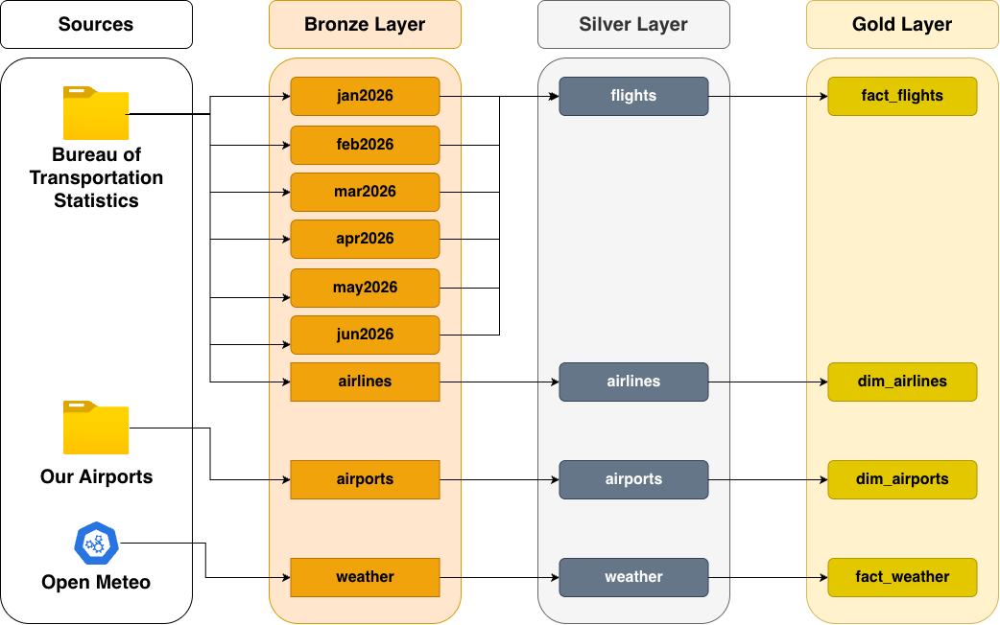

# Travel Data Warehouse

A Databricks data warehouse that combines U.S. flight records, airport reference data, airline carrier codes, and daily airport weather for **January 1 – June 30, 2026**. It follows the **medallion architecture** (Bronze → Silver → Gold) and stores everything as Delta tables.

| Layer | Schema | Purpose |
|---|---|---|
| Bronze | `bronze_travel` | Raw data landed as-is from CSV files and the Open-Meteo API. |
| Silver | `silver_travel` | Cleaning only, per table: trimming, de-duplication, null checks, type fixes, renaming. No merging across tables. |
| Gold | `gold_travel` | Business-ready data model for analysts. |

---

## Data Sources

| Source | Used for | Link |
|---|---|---|
| Bureau of Transportation Statistics (BTS) | Monthly flight records (Jan–Jun 2026) and the airline carrier lookup | https://www.transtats.bts.gov |
| OurAirports | Airport reference data (names, coordinates, region, type) | https://ourairports.com/data/ |
| Open-Meteo Historical Forecast API | Daily weather per airport | https://open-meteo.com/en/docs/historical-forecast-api |

---

## Notebooks

Run them in this order:

| # | Notebook | Reads | Writes |
|---|---|---|---|
| 1 | `bronze_travel` | CSV files in `/Volumes/workspace/bronze_travel/travel_dataset`, Open-Meteo API | `bronze_travel.jan2026` … `jun2026`, `airports`, `airlines`, `weather` |
| 2 | `silver_travel_flights` | `bronze_travel.jan2026` … `jun2026` | `silver_travel.flights` |
| 3 | `silver_travel_airports` | `bronze_travel.airports` | `silver_travel.airports` |
| 4 | `silver_travel_airlines` | `bronze_travel.airlines` | `silver_travel.airlines` |
| 5 | `silver_travel_weather` | `bronze_travel.weather` | `silver_travel.weather` |
| 6 | `gold_travel` | All four `silver_travel` tables | `gold_travel.fact_flights`, `dim_airlines`, `dim_airports`, `fact_weather` |

---

## Bronze Layer

### CSV ingestion
A config list (`INGESTION_CONFIG`) maps each CSV to a Delta table. 

### Selecting airports for weather
OurAirports lists thousands of airports worldwide, but the flight data is primarily U.S. Instead of querying weather for every airport, the notebook collects the distinct `ORIGIN` and `DEST` codes across all six months of flight data and joins them to `bronze_travel.airports` to get coordinates (about 368 airports).

**Known exception:** `PBI` (Palm Beach International) appears in the flight data but not in the airports CSV. The airport was renamed to `DJT` on July 9, 2026, and the CSV was updated on September 1, 2026. The notebook reuses the `DJT` coordinates for the `PBI` code.

### Pulling weather from Open-Meteo
- Endpoint: `https://historical-forecast-api.open-meteo.com/v1/forecast`
- Date range: `2026-01-01` to `2026-06-30` (181 days)
- Daily variables: `temperature_2m_max`, `temperature_2m_min`, `rain_sum`, `showers_sum`, `snowfall_sum`, `precipitation_sum`, `wind_speed_10m_max`, `wind_gusts_10m_max`
- Request settings: `timezone=auto`, `temperature_unit=fahrenheit`, `wind_speed_unit=mph`, `precipitation_unit=inch`
- Airports are sent in **batches of 50** (multiple coordinates per request), with a **60-second pause** between batches to stay under the free-tier limits.
- Failed requests are retried (up to 3 attempts for connection errors).

Free-tier rate limits: 600 calls/min, 5,000/hour, 10,000/day, 300,000/month. The full pull is roughly 3,800 weighted calls, so it takes several minutes.

---

## Silver Layer

Silver does cleaning only. Every table gets the same baseline steps: trim whitespace on all string columns, drop duplicates, null checks, update data types, and normalize/rename columns.

### `silver_travel.flights`
- Unions the six monthly tables with PySpark `unionByName` and verifies the row count equals the sum of the parts.
- Removes duplicates on the business key: `FL_DATE`, `OP_UNIQUE_CARRIER`, `OP_CARRIER_FL_NUM`, `ORIGIN`, `DEST`, `CRS_DEP_TIME`.
- Raises an error if any key column contains nulls.
- Strips the state suffix from `ORIGIN_CITY_NAME` and `DEST_CITY_NAME` (`"New York, NY"` → `"New York"`); raises an error if any value doesn't match the `City, ST` pattern.
- `CANCELLED` and `DIVERTED`: values outside 0/1 are corrected (a cancellation code implies cancelled), then converted to booleans.
- Validates that `CANCELLATION_CODE` is only `A`, `B`, `C`, `D`, or null, and that any row with a code is marked cancelled.

Cancellation codes:

| Code | Meaning |
|---|---|
| A | Carrier caused (maintenance, crew, cleaning, fueling, baggage) |
| B | Weather |
| C | National Aviation System (non-extreme weather, traffic volume, ATC) |
| D | Security |

### `silver_travel.airports`
- `name` must not be null (null rows are dropped).
- `iso_region` has the country prefix removed (`US-NY` → `NY`).

### `silver_travel.airlines`
- Raises an error if any column contains nulls.

### `silver_travel.weather`
- No change

---

## Gold Layer

Gold models the data for analysts and is written as Delta tables.

### `gold_travel.fact_flights`
One row per scheduled flight (Jan–Jun 2026).

| Column | Description |
|---|---|
| `flight_date` | Flight date |
| `airline` | Airline carrier code |
| `carrier_flight_number` | Flight number |
| `origin_iata_code` / `origin_city` / `origin_state` | Origin airport, city, state |
| `destination_iata_code` / `destination_city` / `destination_state` | Destination airport, city, state |
| `scheduled_departure_time` / `actual_departure_time` | Scheduled and actual departure |
| `wheels_off` / `wheels_on` | Takeoff and touchdown times |
| `scheduled_arrival_time` / `actual_arrival_time` | Scheduled and actual arrival |
| `cancelled` | `true` if the flight was cancelled |
| `cancellation_code` | Reason for cancellation (A–D) |
| `diverted` | `true` if the flight was diverted |
| `air_time` | Flight time in minutes |
| `distance` | Distance between airports in miles |
| `carrier_delay`, `weather_delay`, `nas_delay`, `security_delay`, `late_aircraft_delay` | Delay minutes by cause |

### `gold_travel.fact_weather`
One row per airport per day.

| Column | Description | Unit |
|---|---|---|
| `iata_code` | Airport IATA code | |
| `date` | Date of the daily aggregate | |
| `temp_max` / `temp_min` | Highest / lowest air temperature, 2 m above ground | °F |
| `rain_sum` | Rain from large-scale weather systems | in |
| `showers_sum` | Shower (convective) precipitation | in |
| `snowfall_sum` | Total snowfall | in |
| `precipitation_sum` | Total precipitation: rain, showers, and snow (water equivalent) | in |
| `wind_speed_max` | Highest sustained wind speed, 10 m above ground | mph |
| `wind_gusts_max` | Highest wind gust, 10 m above ground | mph |

### `gold_travel.dim_airlines`

| Column | Description |
|---|---|
| `code` | Airline code |
| `name` | Airline carrier name |

### `gold_travel.dim_airports`

| Column | Description |
|---|---|
| `iata_code` | Three-letter IATA code |
| `type` | `balloonport`, `closed_airport`, `heliport`, `large_airport`, `medium_airport`, `seaplane_base`, or `small_airport` |
| `name` | Official airport name |
| `latitude_deg` / `longitude_deg` | Coordinates in decimal degrees |
| `continent` | Continent code (`AF`, `AN`, `AS`, `EU`, `NA`, `OC`, `SA`) |
| `iso_country` | Two-character ISO 3166-1 country code |
| `iso_region` | Region/subdivision code with the country prefix removed |
| `scheduled_service` | `yes` if the airport has scheduled airline service |

### How the tables join

| From | To | Join |
|---|---|---|
| `fact_flights` | `dim_airlines` | `airline = code` |
| `fact_flights` | `dim_airports` | `origin_iata_code = iata_code` (and again on `destination_iata_code`) |
| `fact_flights` | `fact_weather` | `origin_iata_code = iata_code` and `flight_date = date` (and again for the destination) |
| `fact_weather` | `dim_airports` | `iata_code` |